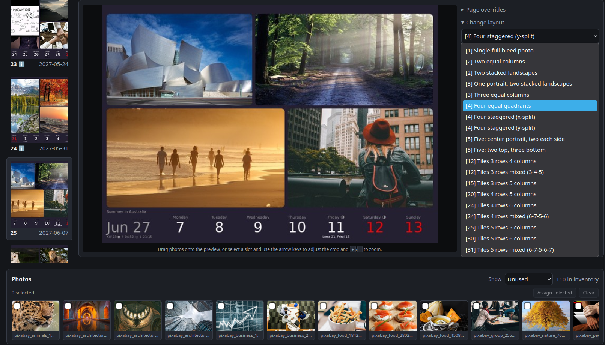
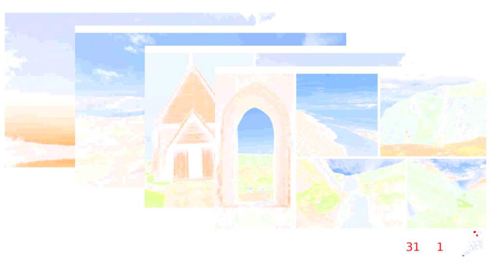

<!-- This README.md is auto-generated from docs/index.md -->

# Photo-Composition-Designer

**Turn a folder of photos into a beautifully designed calendar or collage
book - locally, privately and without a cloud account.**

[](https://github.com/pamagister/Photo-Composition-Designer/actions)
[](https://github.com/pamagister/Photo-Composition-Designer/releases)
[](https://Photo-Composition-Designer.readthedocs.io/en/stable/)
[](https://github.com/pamagister/Photo-Composition-Designer/blob/main/LICENSE)
[](https://github.com/pamagister/Photo-Composition-Designer/issues)
[](https://pypi.org/project/Photo-Composition-Designer/)
[](https://pepy.tech/project/Photo-Composition-Designer/)



## ✨ Features

Photo-Composition-Designer is a local-first desktop app with a browser-based
editor. It helps you turn a directory of photos into calendar pages and collage
layouts, then export them as print-ready images and a PDF.

- 🗓️ **Calendar and collage pages** - weekly pages with a calendar strip,
  holidays, anniversaries and page descriptions.
- 🖱️ **Visual editor** - drag photos into slots, crop and zoom, swap or remove
  them, and see the page update immediately.
- 🧩 **Layouts for every project** - ready-made slot layouts, plus your own
  versioned YAML layouts. Assignments stay put when you change a layout.
- 🗺️ **Maps from your photos** - GPS data is read first, then location names in
  file names. Maps are rendered locally and cached.
- 🎲 **Automatic distribution** - equal, seeded-random or date-aware proposals
  with a preview before anything changes.
- 🖨️ **Print-ready export** - JPG pages and a combined PDF in the project's page
  order, with configurable DPI and quality.
- 🔒 **Local and private** - no accounts, no uploads, no cloud services. Your
  source photos are only read, never modified.
- ♿ **Keyboard accessible** - every drag-and-drop action has a keyboard
  equivalent, with visible focus and labelled controls.
- 📦 **Portable projects** - duplicate projects inside the workspace or exchange
  reference-only `.pcd` archives.

## 🖼️ Example output

*Pages created with Photo-Composition-Designer:*



## 📦 Installation

The PyPI commands below install the app or update an existing installation.

### PyPI (recommended)

Install or update with pip:

```bash
pip install --upgrade Photo-Composition-Designer
```

### Isolated installs

Keep it isolated from your other Python projects with pipx:

```bash
pipx install --force Photo-Composition-Designer
```

Or with uv:

```bash
uv tool install --upgrade Photo-Composition-Designer
```

### Standalone installer

Prefer not to set up Python? Install the Windows app with the installer:

- [⬇️ Download the Windows installer](https://github.com/pamagister/Photo-Composition-Designer/releases/latest/download/photo-composition-designer-setup.exe)

The installer is per-user by default, adds a Start Menu shortcut and starts the
web UI in your browser. The console window stays open while the app runs; close
it or use **Stop server** to quit.

On Linux, download the archive instead:

- [⬇️ Download for Linux](https://github.com/pamagister/Photo-Composition-Designer/releases/latest/download/photo-composition-designer-linux.zip)

Unzip the archive and run `./photo-composition-designer` from a terminal. For
source installs and more options, see
[Installation](docs/getting-started/install.md).

## 🚀 Start the app

Run:

```bash
photo-composition-designer
```

Then open <http://127.0.0.1:8767/> in your browser. The editor runs locally and
does not upload your photos.

## 🧭 Your first project

1. **Create a project** - open **Projects**, choose **New project** and set the
   name, number of pages and first week's start date.
2. **Add your photos** - add a source directory and **Scan** it. Originals are
   only read.
3. **Distribute** - open **Extras > Distribute**, choose a strategy and preview
   the result. **Apply distribution** saves it.
4. **Curate** - drag photos into slots, crop and zoom, edit the page description
   and change the layout.
5. **Export** - export JPG pages, a PDF or both.

The full step-by-step walkthrough is in the [web UI guide](docs/usage/web-ui.md).

## ⚙️ Settings

- **Project settings** - calendar language and holidays, page size and DPI,
  margins, fonts, colors, map mode and the description. Each project keeps its
  own settings.
- **App settings** - the shared `anniversaries.ini` and `locations.ini` files.
- **Layouts** - choose or define the slot layout used by your pages. Layout
  versions are snapshotted per project, so older pages keep their look.

See the [configuration reference](docs/usage/config.md) for all options.

## 🗂️ Storage and exported files

The workspace and caches live in your platform data directory:

```text
~/.local/share/photo-composition-designer/
  workspace.sqlite3
  thumbnails/
  previews/
  cache/
  exports/
```

- `workspace.sqlite3` holds your projects, pages, layouts and assignments.
- `thumbnails/`, `previews/` and `cache/` are disposable and rebuild on demand.
- `exports/` contains rendered pages and PDFs.

`PCD_DATA_DIR` and `PCD_CACHE_DIR` override the default locations.

## 📚 Learn more

- [Web UI guide](docs/usage/web-ui.md) - the complete editor workflow.
- [Configuration reference](docs/usage/config.md) - every setting.
- [CLI reference](docs/usage/cli.md) - scan, distribute, render, export and more.
- [Architecture notes](docs/architecture/web-ui-project-workflow.md) - how the
  workspace and project workflow fit together.
- [Support the project](docs/funding/funding.md) - sponsor, PayPal or crypto.

## 📌 Good to know

- **Reference-only exports** - exported pages point to your source photos.
  Moving a source directory requires relinking it; a `.pcd` archive does not
  contain the photos.
- **No undo history** - every edit is saved immediately. Re-edit a slot or page
  to correct it.
- **One local user** - the editor is designed for a single person on a laptop
  or desktop.
- **No cloud services** - maps are rendered locally; there are no accounts,
  synchronization or online map tiles.

## 🛠️ For developers

Sources, environment setup and checks are described in
[Development tools](docs/develop/tools.md) and the
[installation guide](docs/getting-started/install.md).

---

Licensed under the terms in the [LICENSE](https://github.com/pamagister/Photo-Composition-Designer/blob/main/LICENSE).